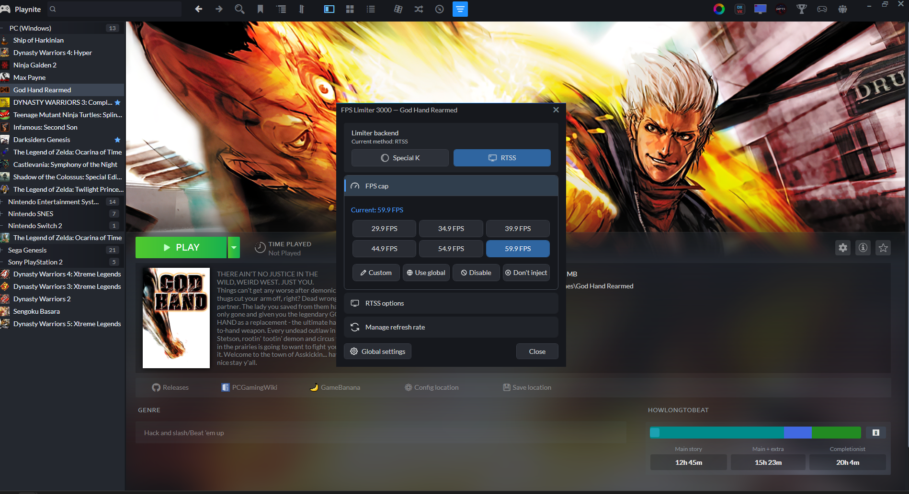
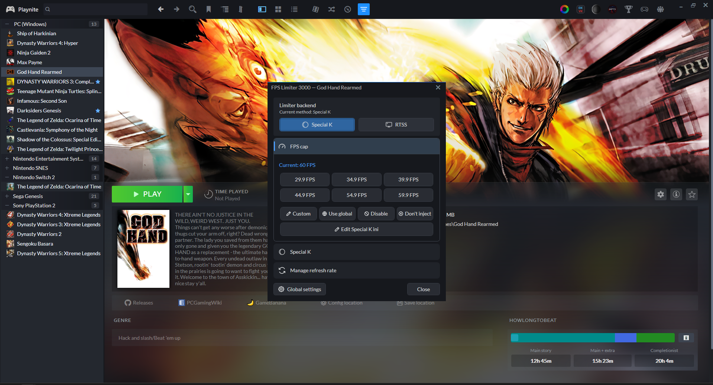
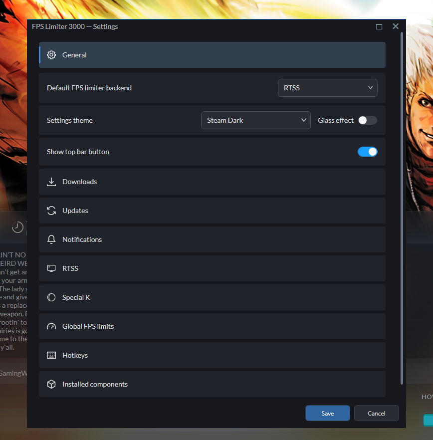

# FPS Limiter 3000

A Playnite extension that caps the frame rate of games launched through Playnite, using **RTSS** (RivaTuner Statistics Server) or **Special K**, with per-game and global limits, sync modes, VRR/refresh-rate handling and a Special K config editor.

This is a fork of [mjd4219/playnite-fps-limiter](https://github.com/mjd4219/playnite-fps-limiter). The original is an RTSS-only limiter; this fork adds a lot on top of it (see below). Credit for the original idea and base code goes to mjd4219.

**AI SLOP. DONT EVEN BOTHER**
## Features

- **Two backends:** RTSS and Special K, chosen globally or per game
- **Global and per-game FPS limits**
- **Sync modes:** Async / Back Edge, Front Edge, Scanline Sync (including half), Special K Latent Sync, NVIDIA Reflex
- **Reflex markers** control
- **FreeSync handling** AMD only
- **Special K integration:** automatic `SpecialK.ini` creation, a built-in ini editor with descriptions, local or global injection per game
- **Fixed refresh-rate support:** helpful options for fixed refresh-rate monitors (refresh rate matching, low-lag vsync option)
- **Special K updater:** checks the Nightly or Discord channel, updates the global install and also refreshes Special K DLLs injected locally into your Playnite games
- **RTSS overlay preset** and RTSS profile access setup, so normal non-admin Playnite works
- Hotkeys and a per-game settings panel

## Screenshots

## Requirements

- Playnite

## Installation

1. Download the latest `.pext` from the [Releases](../../releases) page.
2. Open the file or drag it into Playnite, then restart Playnite if asked.
3. Open the extension settings. For RTSS, use the profile access test and setup once.

## Building

Open `FPSLimiter/FPSLimiter.sln` in Visual Studio 2022 and build the Release configuration, or run `build-fps-limiter.bat` in the project folder to build and pack a `.pext` with Playnite's `Toolbox.exe`. The Release build also compiles the small native FreeSync helper from `native/FreeSyncControl` (see `BUILD.md` there).

## Credits

- [mjd4219](https://github.com/mjd4219) for the original Playnite FPS Limiter
- [RivaTuner Statistics Server](https://www.guru3d.com/page/rtss-rivatuner-statistics-server-download/) by Unwinder
- [Special K](https://github.com/SpecialKO/SpecialK) by Kaldaien
- Oswald font, SIL Open Font License (`OFL-Oswald.txt`)

